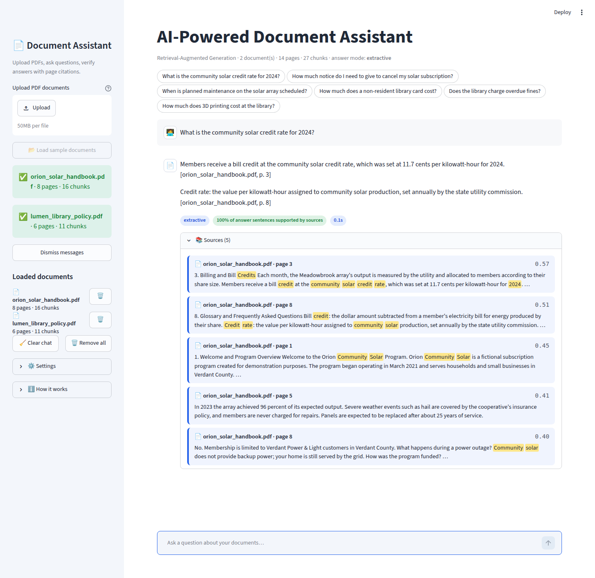
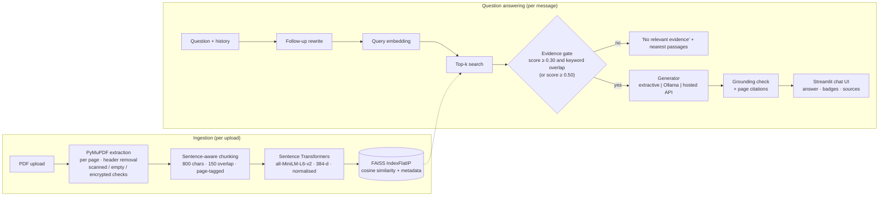
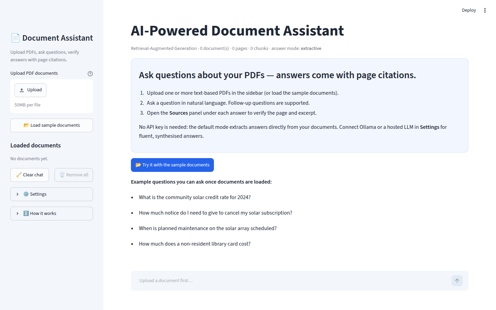
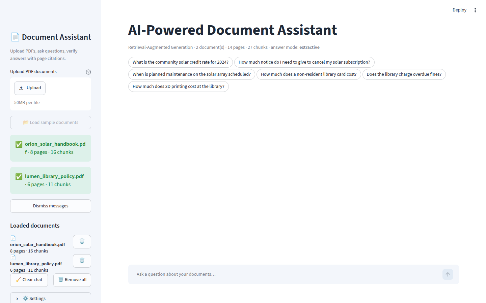
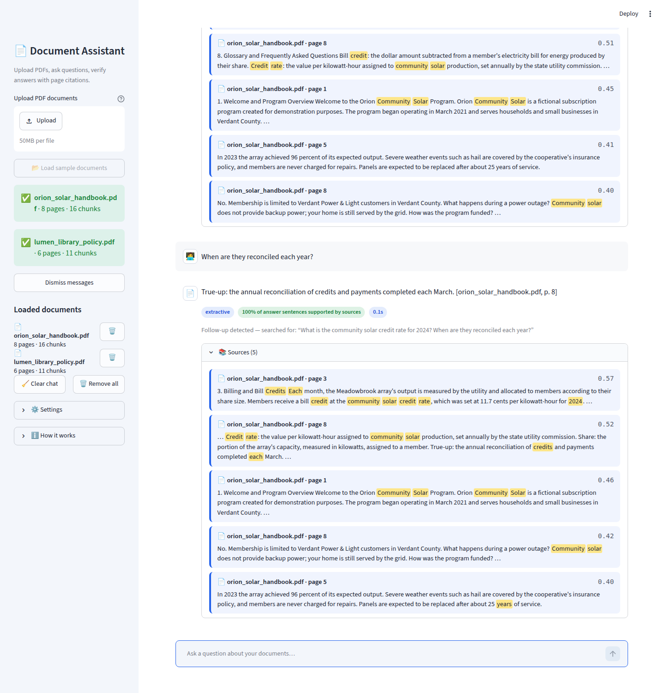
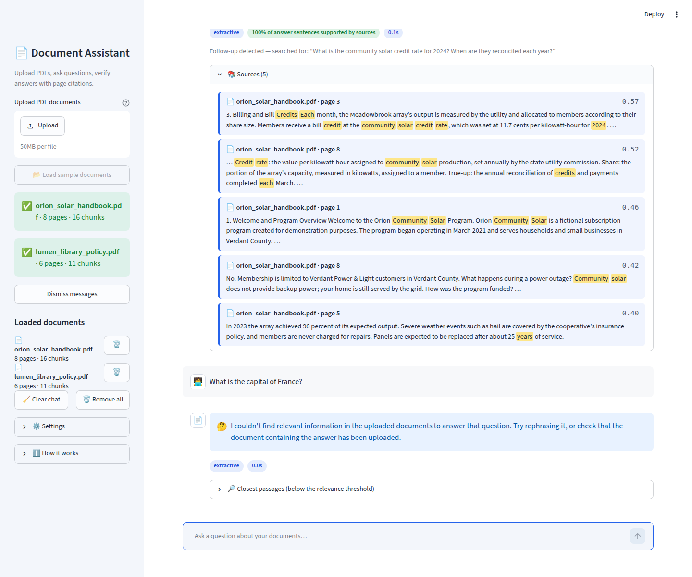
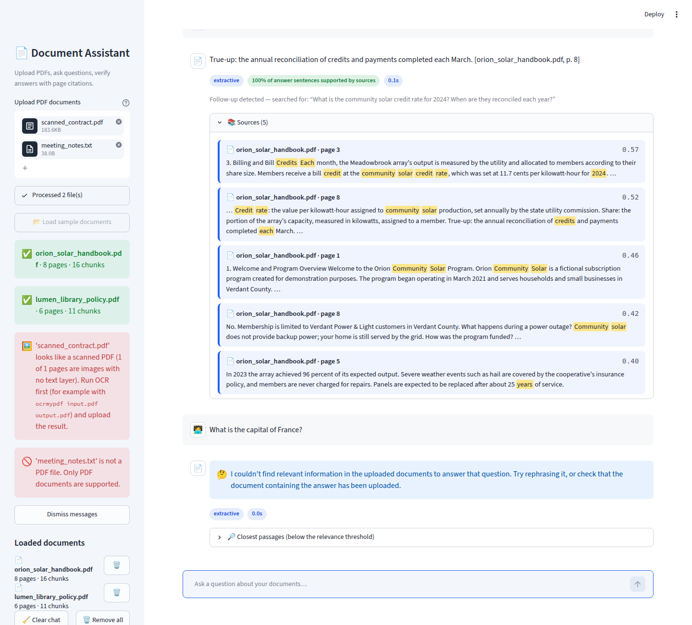

# AI-Powered Document Assistant (RAG)

Upload PDFs, ask questions in plain English, and get answers **grounded in your documents** with
**page-level citations** you can verify. Runs completely free and offline by default (local
embeddings + FAISS + extractive answers); plug in a local Ollama model or a hosted LLM when you want
fluent, synthesised answers.



## Features

- **Multi-PDF upload** with per-file progress, document manager (pages, chunks, remove) and a one-click **sample-document mode** with sample questions.
- **Page-aware chunking**: text is extracted per page with PyMuPDF, running headers/footers are stripped, and sentence-aligned overlapping chunks never cross a page boundary, so every citation points at the exact page.
- **Local semantic search**: `all-MiniLM-L6-v2` embeddings (Sentence Transformers, CPU) in a FAISS cosine-similarity index.
- **Grounded answers, three ways**: extractive sentence ranking (no LLM, no key, default) · local LLM via **Ollama** · optional hosted API (any OpenAI-compatible endpoint or Anthropic). LLM failures fall back to the extractive answer.
- **Evidence gate + grounding check**: questions without supporting passages get a clear "no relevant evidence" message; every answer sentence is checked against the sources and unsupported sentences are flagged.
- **Source panel** per answer: document name, page number, similarity score and a query-focused excerpt with highlighted terms.
- **Follow-up questions** and a clear-chat button; chat history is kept per session.
- **Helpful failure messages** for scanned PDFs (no text layer), empty documents, encrypted PDFs and non-PDF files.
- **Tested and measured**: 65 unit tests, an evaluation script with Recall@k / MRR / grounding / abstention metrics, and a Playwright UI smoke test that produces the screenshots in this README.

## Architecture



A larger diagram is in [docs/architecture.svg](docs/architecture.svg); component responsibilities, data flow and design
decisions are in [docs/architecture.md](docs/architecture.md). A short explanation of RAG is in
[docs/rag_explained.md](docs/rag_explained.md).

**RAG in one paragraph.** Instead of asking a language model to *remember* your documents, the app
indexes them: each page is split into chunks, each chunk is turned into a vector that captures its
meaning, and the vectors are stored in FAISS. When you ask a question, the question is embedded with
the same model, the most similar chunks are retrieved, and the answer is produced *only* from those
chunks, each of which knows its document and page. That is what makes answers verifiable and what
stops the model from inventing facts that are not in the PDFs.

## Quick start

Requirements: Python 3.10+ (tested on 3.12), ~2 GB disk for CPU PyTorch + the embedding model, no GPU needed.

```bash
git clone <your-repo-url> rag-document-assistant
cd rag-document-assistant

# with uv (fast)                              # or with pip
uv venv .venv && source .venv/bin/activate    # python -m venv .venv && source .venv/bin/activate
uv pip install -r requirements.txt            # pip install -r requirements.txt

cp .env.example .env                          # optional: configure Ollama / hosted LLM
streamlit run app.py
```

Open http://localhost:8501, click **Try it with the sample documents**, and ask one of the suggested
questions. The first launch downloads the ~90 MB embedding model from Hugging Face and caches it.

Windows: use `.venv\Scripts\activate` instead of `source .venv/bin/activate`.

### Run the tests and the evaluation

```bash
pip install -r requirements-dev.txt
python -m pytest                         # 65 tests, ~20 s (one test loads the real embedding model)
python evaluation/evaluate.py            # extractive mode; writes evaluation/results/results_extractive.{json,md}
python evaluation/evaluate.py --mode ollama   # if Ollama is running
python sample_data/make_sample_pdfs.py   # regenerate the sample PDFs
```

### Optional: local LLM with Ollama (free)

```bash
# install from https://ollama.com, then
ollama pull llama3.2:3b      # ~2 GB; any instruct model works, set OLLAMA_MODEL to change it
ollama serve                 # usually started automatically
streamlit run app.py         # answer mode "auto" picks Ollama when it is reachable
```

### Optional: hosted LLM API

Set **one** of these in `.env` (local) or in Streamlit secrets (cloud). No hosted service is required and none is assumed to be free.

| Variable | Purpose |
| --- | --- |
| `HOSTED_PROVIDER` | `openai` (default; works with any OpenAI-compatible endpoint such as OpenAI, Groq, OpenRouter, Together) or `anthropic` |
| `OPENAI_API_KEY`, `OPENAI_BASE_URL`, `OPENAI_MODEL` | OpenAI-compatible endpoint; e.g. `OPENAI_BASE_URL=https://api.groq.com/openai/v1` |
| `ANTHROPIC_API_KEY`, `ANTHROPIC_MODEL` | Anthropic Messages API |
| `ANSWER_MODE` | `auto` (default) · `extractive` · `ollama` · `hosted` |

All settings are listed in [.env.example](.env.example). Retrieval knobs: `CHUNK_SIZE`, `CHUNK_OVERLAP`, `TOP_K`,
`SCORE_THRESHOLD`, `STRONG_SCORE`, `EMBEDDING_MODEL`.

## Using the app

| | |
| --- | --- |
|  |  |
| Empty state with instructions and sample-document mode | Documents indexed with page/chunk counts and sample questions |
|  |  |
| Follow-up question ("When are *they* reconciled?") resolved against the previous turn | Off-topic question: clear message plus the nearest passages for transparency |



Scanned PDFs, empty files, encrypted PDFs and non-PDF uploads each get a specific message instead of a silent failure.

**Tips**

- Open **Settings** in the sidebar to switch answer mode, change top-k, adjust the relevance threshold or hide scores.
- Re-uploading a file with the same name replaces the previous copy. Use the 🗑️ button to remove a document from the index.
- Clear chat keeps the documents; **Remove all** clears both.

## Evaluation results

Measured by running `python evaluation/evaluate.py` on this machine (CPU, Python 3.12) over the two
sample PDFs (14 pages, 27 chunks) with 30 answerable questions, 8 unanswerable questions and
4 two-turn follow-up conversations. Full per-question tables: [evaluation/results/results_extractive.md](evaluation/results/results_extractive.md).

| Metric (extractive mode, no LLM) | Result |
| --- | --- |
| Recall@1 / Recall@3 / Recall@5 (expected page retrieved) | **86.7 % / 96.7 % / 100 %** |
| MRR (mean reciprocal rank of the expected page) | **0.918** |
| Correct document at rank 1 (two documents loaded) | **100 %** |
| Answer contains the expected fact (keyword hit) | **100 %** (30/30) |
| Answers fully grounded in retrieved text | **100 %** (mean grounding score 1.0) |
| Abstained on unanswerable questions | **87.5 %** (8/8 off-topic, 3/4 in-domain traps) |
| Follow-up Recall@3 with / without conversation history | **100 % / 75 %** |
| Mean latency per question (retrieval + answer) | **0.08 s** |

Honest notes: the sample documents are short and written for this project, so these numbers are an
upper bound for clean, well-structured PDFs. The one missed abstention ("How many solar panels are
installed?") is a question whose *topic* is covered but whose *fact* is not, the hardest case for a
similarity-based gate. Ollama and hosted modes were **not** evaluated here because neither was
available on the development machine; run `evaluate.py --mode ollama|hosted` to produce those tables.

## Project structure

```
.
├── app.py                      Streamlit UI
├── rag/                        library package (no Streamlit dependency)
│   ├── config.py               Settings from env vars / secrets
│   ├── pdf_loader.py           PyMuPDF extraction + failure detection + header removal
│   ├── chunking.py             sentence-aware overlapping chunks with page metadata
│   ├── embeddings.py           Sentence Transformers wrapper + offline test embedder
│   ├── vector_store.py         FAISS index + metadata, remove/save/load
│   ├── retriever.py            top-k search + hybrid evidence gate
│   ├── followup.py             follow-up question rewriting
│   ├── generators.py           extractive / Ollama / hosted generators + grounded prompt
│   ├── citations.py            page citations, excerpts, highlighting
│   ├── grounding.py            answer-grounding check
│   └── pipeline.py             RAGPipeline: ingest() and ask()
├── sample_data/                generated sample PDFs, sample questions, sourcing guide
├── evaluation/                 eval_questions.json, evaluate.py, results/
├── tests/                      pytest suite (parsing, chunking, store, retrieval, citations, grounding, pipeline)
├── scripts/take_screenshots.py Playwright UI smoke test + screenshots
├── docs/                       architecture, RAG explainer, interview Q&A, screenshots
├── .streamlit/config.toml      theme + server settings (secrets.toml.example for cloud)
├── requirements.txt            runtime deps (CPU torch index)   · requirements-dev.txt for tests/screenshots
└── .env.example · .gitignore · LICENSE (MIT) · pyproject.toml
```

## Deployment

### Streamlit Community Cloud (free)

1. Push this repository to GitHub (public or private).
2. At https://share.streamlit.io choose **New app**, select the repo, branch `main`, main file `app.py`, and Python 3.12 under *Advanced settings*.
3. (Optional) paste the contents of [.streamlit/secrets.toml.example](.streamlit/secrets.toml.example) into **Secrets** and fill in an API key to enable a hosted LLM. Without secrets the app runs in extractive mode.
4. Deploy. The first start takes a few minutes: pip installs CPU PyTorch (the `--extra-index-url` line in `requirements.txt` keeps it small) and the embedding model is downloaded on first use.

Resource constraints to know about:

- Community Cloud apps get roughly **1 GB of RAM**. `all-MiniLM-L6-v2` + CPU torch + FAISS use ~500–700 MB, which fits; larger embedding models (`bge-base`, `e5-large`) may not. Keep `EMBEDDING_MODEL` small.
- **Ollama is not available** on Community Cloud (no local model server). Use extractive mode or a hosted API via secrets.
- Uploaded files and the index live in memory for the session only; nothing is persisted between restarts (by design for a shared demo). Apps sleep after inactivity and cold-start again.
- `maxUploadSize` is 50 MB per file (`.streamlit/config.toml`); very large PDFs will take minutes to embed on the shared CPU.

### Other options

- **Hugging Face Spaces (Streamlit SDK)**: same files; set secrets in the Space settings. 16 GB RAM on the free tier allows bigger embedding models.
- **Docker / VM**: `pip install -r requirements.txt && streamlit run app.py --server.port 8501 --server.address 0.0.0.0`. Run Ollama on the same host to get free local generation.

## Troubleshooting

| Symptom | Fix |
| --- | --- |
| First run is slow or fails with a Hugging Face connection error | The embedding model (~90 MB) is downloaded on first use. Check internet access or pre-download: `python -c "from sentence_transformers import SentenceTransformer as S; S('sentence-transformers/all-MiniLM-L6-v2')"` |
| `RuntimeError: Tried to instantiate class '__path__._path'` in the terminal | Streamlit's file watcher inspecting torch. `.streamlit/config.toml` sets `fileWatcherType = "none"`; keep it, or set it to `"poll"` if you want hot reload |
| "looks like a scanned PDF" | The PDF has no text layer. Run OCR first, e.g. `ocrmypdf input.pdf output.pdf`, then upload the output |
| "is password protected" | Remove the password (e.g. `qpdf --decrypt --password=... in.pdf out.pdf`) and re-upload |
| Answer says no relevant evidence although the fact is in the PDF | Rephrase using words from the document, raise `TOP_K`, or lower the relevance threshold in Settings. Check the "Closest passages" panel to see what was retrieved |
| Ollama mode not offered in Settings | Ollama must be reachable at `OLLAMA_BASE_URL` and the model pulled (`ollama pull llama3.2:3b`). The sidebar shows the detected status |
| Hosted mode errors (401/404/429) | Verify the key, `OPENAI_BASE_URL` and model name for your provider; rate limits and billing are the provider's, not the app's |
| `faiss` import error on Apple Silicon / old pip | `pip install --upgrade pip` then reinstall `faiss-cpu`; wheels exist for Python 3.9–3.13 |
| Tokenizers "fork" warning | Harmless; set `TOKENIZERS_PARALLELISM=false` |

## Limitations

- **Text-only PDFs.** No built-in OCR; scanned documents must be OCR'd first. Tables and multi-column layouts are flattened to text, which can break their reading order.
- **Extractive answers do not synthesise.** The default mode returns the best source sentences verbatim; it will not combine facts from several passages or rephrase. Use Ollama or a hosted model for that.
- **Small embedding model.** MiniLM is fast but rates topical similarity highly; questions whose topic is covered but whose fact is absent can slip past the evidence gate (1 of 4 such traps in the evaluation).
- **Grounding check is lexical.** It catches sentences with no support in the sources, not subtle logical errors in LLM output.
- **Follow-up handling is heuristic.** It prepends the previous question; long multi-turn reference chains are not tracked.
- **Session-scoped, in-memory index.** Documents are re-processed in a new session; there is no multi-user persistence, authentication or document-level access control.
- **English-centric.** The sentence splitter, stopword list and default embedding model are tuned for English.
- Ollama and hosted-LLM modes are implemented and unit-tested for error handling, but their answer quality was not measured on this machine.

## Resume description

> **AI-Powered Document Assistant (RAG)** — Python, Streamlit, PyMuPDF, Sentence Transformers, FAISS.
> Built an end-to-end retrieval-augmented question-answering app that lets users upload multiple PDFs and ask natural-language questions, returning answers grounded in the documents with page-level citations and highlighted excerpts. Implemented page-aware sentence chunking, local MiniLM embeddings with a FAISS cosine index, a hybrid semantic + lexical evidence gate to decline unanswerable questions, pluggable generators (extractive, Ollama, hosted API) with automatic fallback, and a deterministic answer-grounding check. Wrote 65 unit tests and an evaluation harness measuring Recall@k, MRR, grounding and abstention (Recall@5 100 %, MRR 0.92, 100 % grounded answers on the benchmark set); automated UI testing and screenshots with Playwright; documented architecture and deployment to Streamlit Community Cloud.

Interview preparation: [docs/interview_qa.md](docs/interview_qa.md).

## Before you claim this project as finished

- [ ] Run `python -m pytest` and `python evaluation/evaluate.py` yourself and confirm the numbers above on your machine; update the table if they differ.
- [ ] Launch the app, load the sample documents, and try every feature in the screenshots (upload, remove, follow-up, clear chat, bad files).
- [ ] Test with **your own real PDFs** (see [sample_data/README.md](sample_data/README.md) for legally reusable sources) and note where retrieval or extraction struggles.
- [ ] If you have Ollama or an API key, run `evaluate.py --mode ollama` / `--mode hosted`, commit the result tables, and compare answer quality with the extractive mode.
- [ ] Push to GitHub, deploy to Streamlit Community Cloud, and add the live URL to this README.
- [ ] Replace `<your-repo-url>` above and review the LICENSE author line.
- [ ] Be able to explain, without notes, every question in [docs/interview_qa.md](docs/interview_qa.md), especially the chunking, FAISS, evidence-gate and evaluation decisions.
- [ ] Read through `rag/pipeline.py` and `app.py` end to end so you can walk an interviewer through the code.

## License

MIT — see [LICENSE](LICENSE). Sample documents are original fictional text created for this project.
