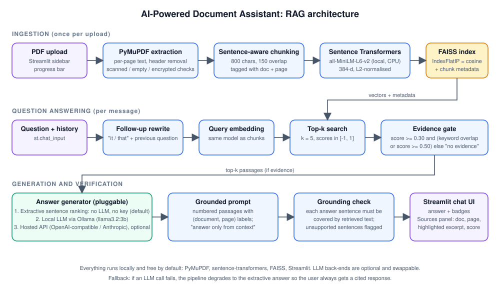

# System architecture

## Component map

| Layer | Module | Responsibility |
| --- | --- | --- |
| UI | `app.py` | Streamlit chat interface: uploads with progress, document manager, sample mode, chat history, source panels, settings |
| Orchestration | `rag/pipeline.py` | `RAGPipeline.ingest()` and `RAGPipeline.ask()`; wires loader → chunker → embedder → FAISS → retriever → generator → grounding |
| Parsing | `rag/pdf_loader.py` | PyMuPDF text extraction per page, running header/footer removal, detection of scanned, empty, encrypted and non-PDF files |
| Chunking | `rag/chunking.py` | Sentence-aware, overlapping chunks that never cross a page boundary; each chunk carries `doc_name`, `page_number`, char offsets |
| Embeddings | `rag/embeddings.py` | `EmbeddingModel` (Sentence Transformers, normalised vectors) and `HashingEmbedder` (offline test double) |
| Vector store | `rag/vector_store.py` | `FaissVectorStore`: exact inner-product index + chunk metadata, per-document removal, save/load |
| Retrieval | `rag/retriever.py` | Query embedding, top-k search, hybrid evidence gate (semantic threshold + informative-keyword overlap) |
| Follow-ups | `rag/followup.py` | Rewrites pronoun-heavy or very short questions by prepending the previous question for retrieval |
| Generation | `rag/generators.py` | `ExtractiveGenerator` (sentence ranking), `OllamaGenerator`, `HostedGenerator`; shared grounded prompt; mode auto-detection |
| Citations | `rag/citations.py` | Page-level `Citation` objects with query-focused excerpts and HTML highlighting |
| Verification | `rag/grounding.py` | Deterministic sentence-level support check (unigram/bigram coverage) used by the UI badge and the evaluation |
| Config | `rag/config.py` | `Settings.from_env()` — every knob is an environment variable or Streamlit secret |

## Data flow

**Ingestion** (per uploaded file)

1. Bytes are validated (`%PDF` header) and opened with PyMuPDF. Encrypted files, files with zero pages, image-only pages (scanned) and files with no text layer are reported with a specific message instead of being indexed.
2. Each page's text is cleaned (hyphenation, whitespace, control characters). Lines that repeat at the top/bottom of most pages (running headers, "Page 3 of 8") are stripped so they do not pollute embeddings or answers.
3. Pages are split into sentence-aligned chunks of ~800 characters with ~150 characters of overlap. Chunks never span pages, so every chunk maps to exactly one `(document, page)`.
4. Chunks are embedded in batches with `all-MiniLM-L6-v2` (384 dimensions, L2-normalised) and added to a FAISS `IndexFlatIP`, which therefore computes cosine similarity. A progress callback updates the UI.

**Question answering** (per message)

1. If the question looks like a follow-up ("When is *it* paid?"), the previous user question is prepended to the retrieval query. The raw chat history is also passed to LLM generators.
2. The query is embedded with the same model and the top-k chunks are retrieved.
3. The **evidence gate** decides whether to answer: the best score must reach `SCORE_THRESHOLD` (0.30) **and** either exceed `STRONG_SCORE` (0.50) or share at least one informative keyword with the passages. Words that appear in >30 % of a document's chunks ("library", "member") do not count as informative. Below the gate the assistant says it could not find relevant information and shows the nearest passages for transparency.
4. The generator produces the answer:
   * **Extractive** (default): every sentence of the retrieved chunks is embedded and scored against the question (65 % sentence similarity + 20 % parent-chunk score + 15 % keyword coverage). The top sentences above an absolute and relative cutoff are returned verbatim, each with its `[document, p. N]` citation.
   * **Ollama / hosted LLM**: a grounded prompt with numbered `(document, page)` passages instructs the model to answer only from the context and to cite inline. If the call fails, the pipeline falls back to the extractive answer and tells the user.
5. The **grounding check** splits the answer into sentences and verifies each against the retrieved text. The UI shows "100 % of answer sentences supported" or lists the unsupported sentences for review.
6. Citations (document, page, highlighted excerpt, similarity score) are rendered in the Sources panel.

## Key design decisions

* **Page-bounded chunks** trade a little context continuity for exact page citations, which is the product's core promise.
* **Exact FAISS search** (`IndexFlatIP`) is used because a session holds thousands, not millions, of chunks; it is simpler and has no recall loss. Switching to `IndexHNSWFlat` or `IndexIVFFlat` is a one-line change for large corpora.
* **Free-first**: embeddings, retrieval and the default answer mode run on CPU with no network access after the first model download. LLMs are strictly optional and configured via environment variables or `st.secrets`.
* **Hybrid evidence gate**: small embedding models rate *topically* similar text highly, so a pure cosine threshold either blocks paraphrases or admits off-topic questions. Adding a corpus-aware keyword check fixed the in-domain false positives seen during evaluation without hurting recall.
* **Deterministic grounding check** instead of an LLM judge keeps evaluation free, repeatable and runnable in CI.
* **Session-scoped index**: each browser session owns its own `RAGPipeline`; the embedding model is shared through `st.cache_resource`. Persistence (`FaissVectorStore.save/load`) exists for scripts and tests but is intentionally not exposed in a multi-user deployment.
